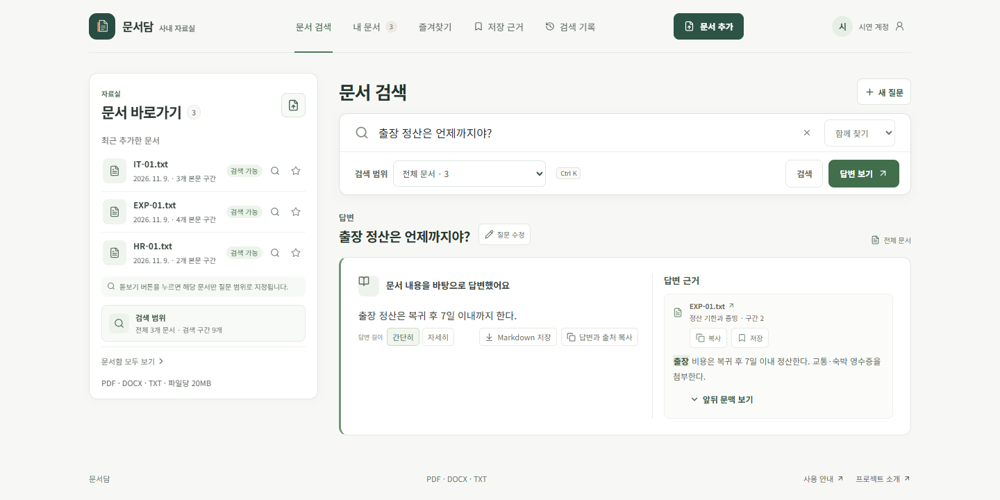
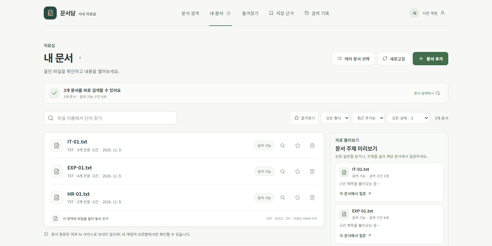
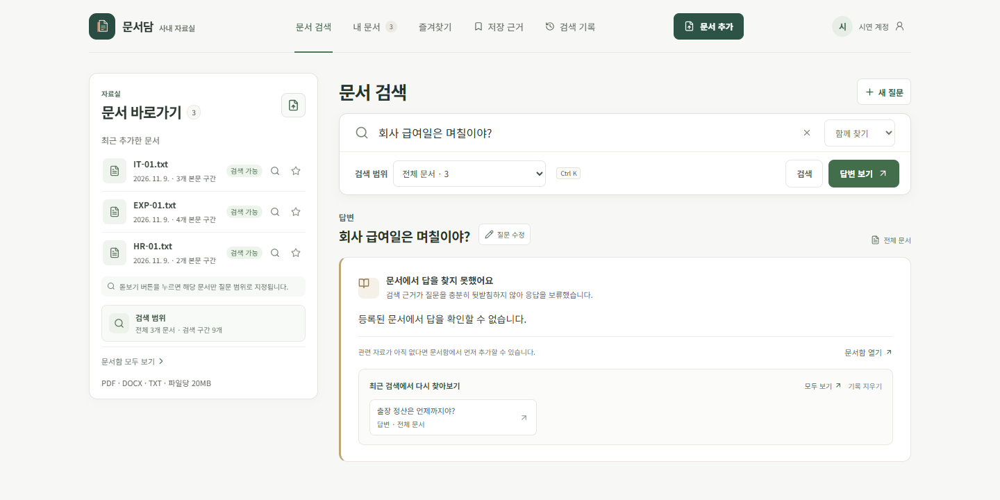
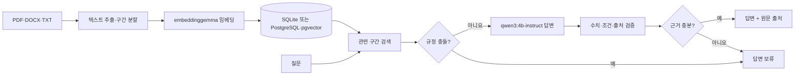

# 문서담

**사내 문서에서 답을 찾고, 답의 근거를 원문까지 따라가는 로컬 AI 웹 앱**

[](https://github.com/fevvbbwg/munsodam/actions/workflows/ci.yml)

PDF·DOCX·TXT를 등록하면 문서 내용을 추출하고 검색 가능한 구간으로 나눕니다. 질문에는 관련 문장을 찾은 뒤 출처와 함께 답하며, 근거가 부족하면 답변을 보류합니다. LLM은 Ollama의 `qwen3:4b-instruct`, 임베딩은 `embeddinggemma`를 로컬에서 사용합니다. 외부 AI API는 호출하지 않습니다.



> 화면은 실제 제품을 로컬에서 실행해 촬영했습니다. 문서와 계정은 공개용 **가상 예시**이며, 답변은 지정한 Ollama 모델이 생성했습니다.

## 1분 안에 보는 사용 흐름

1. **문서 등록** — PDF·DOCX·TXT를 올리면 텍스트를 추출하고 구간별 임베딩을 만듭니다.
2. **질문** — 의미·키워드·통합 검색으로 원문을 찾거나, 근거에 기반한 답변을 요청합니다.
3. **확인** — 답변 옆 출처 카드에서 파일명, 문서 위치, 원문 발췌를 보고 해당 구간으로 이동합니다.
4. **보류** — 자료에 없거나 같은 규정의 문서별 값이 다르면 답을 단정하지 않고 이유를 안내합니다.

| 내 문서 | 근거가 없는 질문 |
| :---: | :---: |
|  |  |

[사진으로 따라가는 시연](docs/demo-walkthrough.md) · [모바일 답변 화면](docs/media/answer-mobile.png) · [회원가입 화면](docs/media/signup.png)

## AI 답변에서 신경 쓴 점



- **출처는 서버가 조립합니다.** 모델이 써 준 파일명이나 위치를 그대로 믿지 않고, 실제 검색 구간 ID와 대조해 원문 링크를 만듭니다.
- **수치와 조건을 다시 확인합니다.** 금액·기한·전후 조건이 인용 원문과 어긋나면 재생성하고, 확인되지 않으면 보류합니다.
- **복합 질문의 각 항목을 확인합니다.** 서로 다른 규정 두 개를 묻는 경우 한쪽만 답한 부분 응답을 걸러냅니다.
- **규정 충돌을 구분합니다.** 같은 항목에 서로 다른 금액·기한·허용 여부가 검색되면 충돌한 원문 두 곳을 보여 주고 적용 연도를 묻거나 문서 범위를 좁히도록 안내합니다. 두 연도를 비교해 달라고 하면 각각의 근거를 찾아 함께 답합니다.
- **문서 안의 지시는 데이터로 취급합니다.** 검색된 문서가 모델에 새로운 행동을 지시해도 답변 규칙으로 받아들이지 않습니다.

구현의 선택과 실패 사례는 [프로젝트 사례 문서](docs/portfolio-case-study.md), 새 질문으로 발견해 수정한 복합 답변 오류는 [AI 답변 점검 기록](docs/ai-quality-review.md), 재현 가능한 질문과 채점 방식은 [평가 안내](evaluation/README.md)에 기록했습니다.

## 측정 결과와 해석

| 격리 SQLite API + 로컬 Ollama | 결과 |
| --- | ---: |
| Recall@5 | 24/24 |
| 답변 핵심 사실 포함 | 24/24 |
| 필수 출처 인용 | 24/24 |
| 답변 불가 질문 보류 | 12/12 |
| `/api/chat` 중앙 응답 시간 | 1,478 ms |

수치는 [2026-11-09 골드 회귀 보고서](evaluation/results/gold_20261109_212206.json)의 36개 질문 결과입니다. 문서 3개와 질문은 기획서 규칙을 바탕으로 직접 재구성했고 개발 중 반복 사용했습니다. **독립 블라인드 평가나 실제 사내 문서 성능을 뜻하지 않습니다.** 핵심 문구 자동 채점에도 동의어 판정 한계가 있습니다. 문서 간 충돌을 포함한 추가 소규모 시험의 원본·결과는 [AI 답변 점검 기록](docs/ai-quality-review.md)과 [평가 안내](evaluation/README.md)에서 볼 수 있습니다.

## 실행해 보기

필요한 것: Docker Desktop, Ollama, 그리고 아래 두 모델. 모델 이름을 임의로 바꾸거나 외부 AI 서비스로 대체하지 않습니다.

```powershell
ollama pull qwen3:4b-instruct
ollama pull embeddinggemma
Copy-Item .env.example .env
docker compose up --build
```

웹은 <http://localhost:5173>, API 문서는 <http://localhost:8000/docs>에서 열립니다. 이메일로 계정을 만든 뒤 첫 화면에서 **예시 문서 3개 추가**를 누르면 공개용 가상 자료로 검색·답변·보류 흐름을 체험할 수 있습니다. 카카오 로그인과 비밀번호 재설정 메일은 각각 개발자 키와 SMTP 설정이 있어야 활성화됩니다.

Docker 없이 Windows에서 실행하는 방법, 환경변수, 개별 API, 테스트 명령은 [실행 및 기술 참고](docs/technical-reference.md)에 정리했습니다. 이 저장소는 소스 공개이며 **인터넷에서 바로 접속하는 호스팅 데모는 제공하지 않습니다.**

## 구성과 확인 범위

| 영역 | 기술 |
| --- | --- |
| 웹 | React 18, TypeScript, Vite |
| API | FastAPI, Python 3.12 |
| 저장 | Compose: PostgreSQL·pgvector / Windows 로컬 개발: SQLite |
| AI | 로컬 Ollama `qwen3:4b-instruct`, `embeddinggemma` |
| 품질 확인 | API·웹 회귀 테스트, 웹 빌드, 합성 문서 기반 Ollama 통합 평가 |

GitHub Actions는 API 테스트와 웹 테스트·빌드를 실행합니다. CI에서는 실제 Ollama 추론, SMTP 발송, 카카오 인증, PostgreSQL 배포 경로를 확인하지 않습니다. 스캔 이미지 PDF의 OCR, 조직별 권한·공유 정책, 접근 감사 기록도 현재 범위 밖입니다. 실제 조직에 배포하려면 해당 기능과 실제 문서 기반 평가를 추가해야 합니다.

## 코드 둘러보기

- [`web/`](web/) — 검색·문서함·근거·계정 화면
- [`server/app/`](server/app/) — 문서 추출, 검색, 답변 검증, 인증 API
- [`evaluation/`](evaluation/) — 질문 세트, 평가 스크립트, 결과 원본
- [`docs/portfolio-case-study.md`](docs/portfolio-case-study.md) — 사용자 흐름, 설계 선택, 실패와 개선 기록
- [`docs/demo-walkthrough.md`](docs/demo-walkthrough.md) — 실제 화면으로 따라가는 문서 등록·검색·답변·보류
- [`docs/ai-quality-review.md`](docs/ai-quality-review.md) — 추가 질문으로 점검한 AI 답변과 발견한 오류
- [`docs/technical-reference.md`](docs/technical-reference.md) — 설치·설정·테스트와 상세 구현 범위
