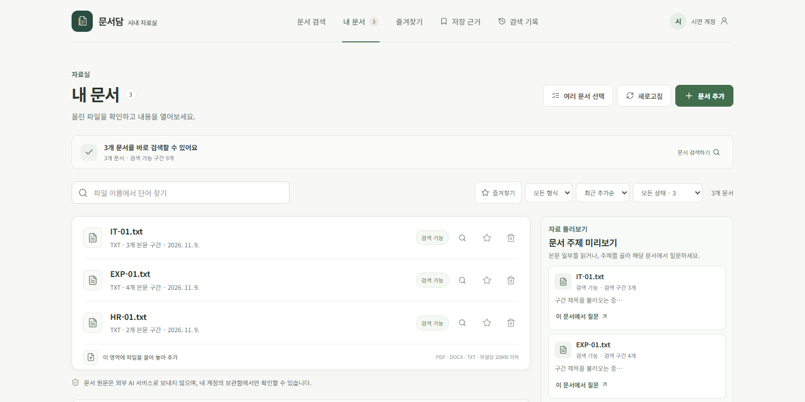
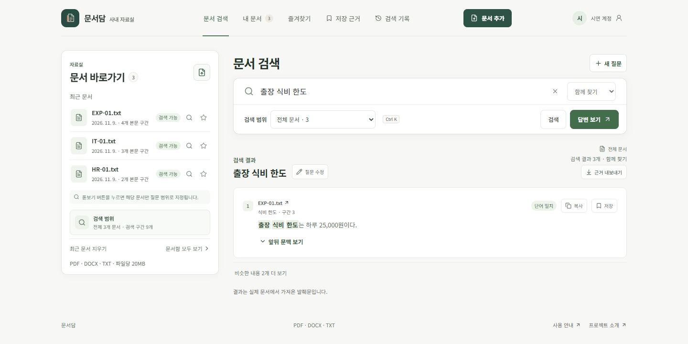
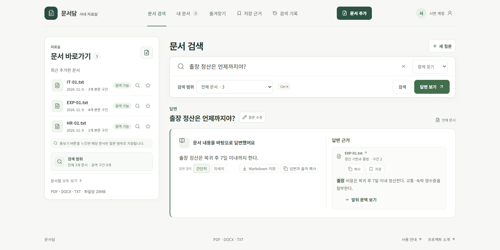
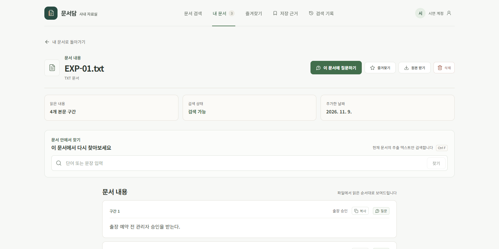
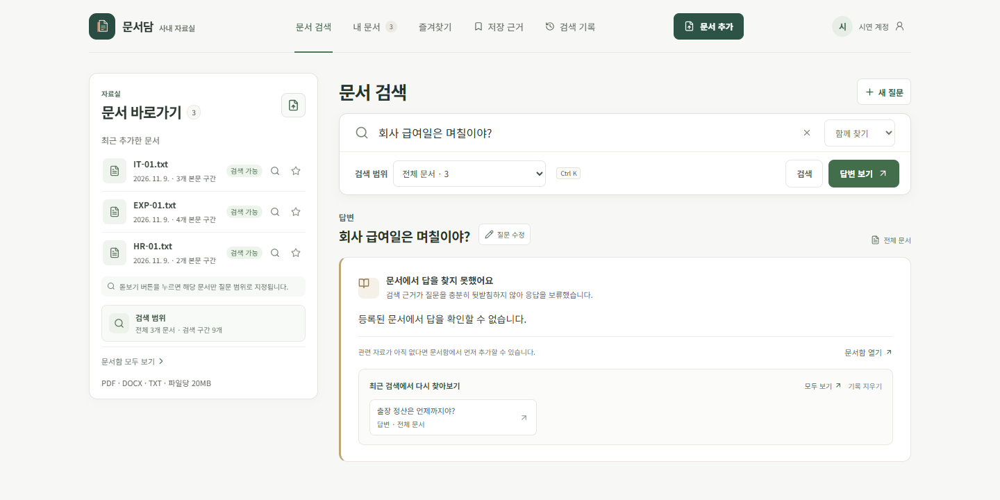
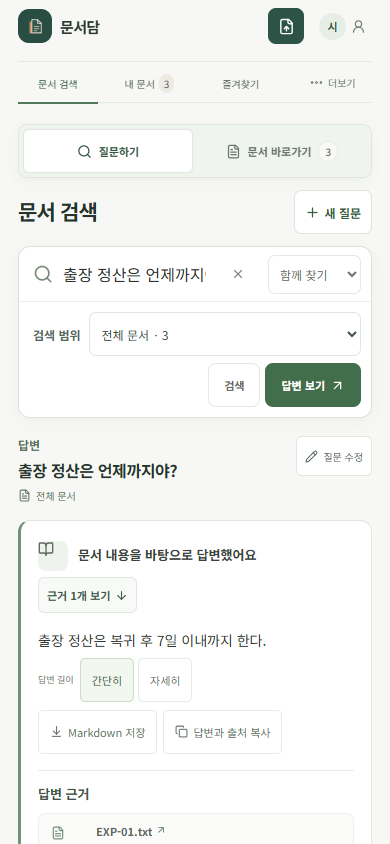

# 문서담 시연: 문서를 올리고 답의 출처까지 확인하기

이 문서는 저장소를 처음 보는 사람이 실제 화면을 따라가며 핵심 기능을 확인하도록 만든 안내입니다. 모든 캡처는 2026-11-09에 별도의 임시 SQLite 자료실, 시연 계정, [`evaluation/docs/`](../evaluation/docs/)의 **가상 문서 3개**로 촬영했습니다. 검색·답변에는 로컬 Ollama의 `embeddinggemma`와 `qwen3:4b-instruct`를 사용했습니다. 실제 회사 문서나 개인 계정 화면은 포함하지 않았습니다.

## 1. 문서 등록

이메일로 계정을 만든 뒤 홈 화면에서 `예시 문서 3개 추가`를 누르면 휴가·출장·기기 보안 가상 문서가 등록됩니다. 직접 만든 텍스트 기반 PDF, DOCX, TXT도 올릴 수 있습니다. 문서함에서는 파일명·형식·상태로 좁혀 보고, 원문과 추출 상태를 확인하거나 삭제할 수 있습니다.

## 2. 원하는 문장 찾기

검색 화면에서 `출장 식비 한도`를 입력하고 **검색**을 누릅니다. 아래처럼 원문 구간이 표시되며, 파일명과 구간 위치를 확인할 수 있습니다. 의미·키워드·통합 검색을 선택할 수 있고, 검색 범위를 문서 하나로 좁힐 수도 있습니다.

## 3. 답과 근거 확인

`출장 정산은 언제까지야?`라고 묻고 **답변 보기**를 누릅니다. 답변 `복귀 후 7일 이내` 옆에 `EXP-01.txt`의 정산 기한 구간이 출처로 표시됩니다. 출처를 누르면 저장된 원문 위치로 이동합니다. 답변과 근거는 복사하거나 Markdown으로 저장할 수 있습니다.

원문 화면은 파일에서 추출한 구간을 순서대로 보여 줍니다. 문서 안에서 다시 찾거나 해당 문서만 범위로 삼아 질문을 이어갈 수 있습니다.

## 4. 자료에 없는 질문

`회사 급여일은 며칠이야?`는 등록한 세 문서에 답이 없습니다. 이때 날짜를 만들어 내지 않고, 답변을 보류하며 관련 자료를 추가하도록 안내합니다. 이 장면의 보류는 하나의 예시이고, 모든 미기재 질문을 완벽하게 걸러낸다는 뜻은 아닙니다.

## 5. 좁은 화면에서도 사용

모바일 화면에서는 질문과 문서 바로가기를 탭으로 전환하고, 답변 아래에서 출처를 펼쳐 원문을 확인합니다.

## 직접 재현하기

[README의 실행 명령](../README.md#실행해-보기)으로 앱을 실행한 뒤 계정을 만들고 `예시 문서 3개 추가`를 누릅니다. 이 자료는 데모용이지만 일반 업로드 문서처럼 실제 문서함에 저장되므로, 필요한 경우 문서함에서 직접 삭제할 수 있습니다. 모델 설치나 연결에 문제가 있으면 `/api/ready`의 상태를 확인합니다. 자세한 설정은 [실행 및 기술 참고](technical-reference.md)에 있습니다.

AI 품질을 더 깊이 확인하려면 [평가 세트와 한계](../evaluation/README.md), 설계 변경의 근거는 [프로젝트 사례 문서](portfolio-case-study.md)를 참고하세요.
