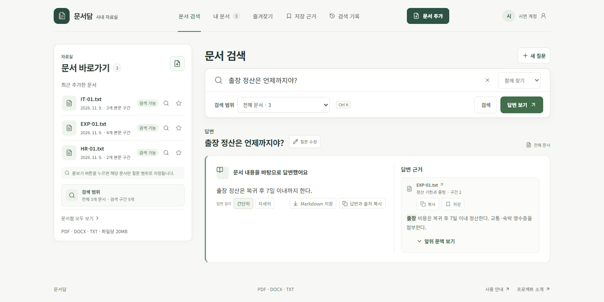

# 문서담 — 사내 자료를 위한 근거 중심 검색



[사진으로 따라가는 시연](demo-walkthrough.md) · [AI 답변 추가 점검](ai-quality-review.md) · [실행 방법](technical-reference.md)

## 한눈에 보기

문서담은 PDF, DOCX, TXT를 등록하고 자연어 질문으로 관련 내용을 찾는 로컬 우선 문서 검색 웹 앱이다. 검색 결과에는 원문 발췌와 문서 위치를 붙이며, 근거가 충분하지 않으면 답변을 보류한다. 답변 분량은 간결하게 또는 자세하게 선택할 수 있으며, 같은 검색 근거를 유지한다. 외부 AI API를 호출하지 않고 Ollama의 `embeddinggemma`와 `qwen3:4b-instruct`만 사용한다.

| 구분 | 구성 |
| --- | --- |
| 웹 | React 18, TypeScript, Vite |
| API | FastAPI, Python |
| 배포 저장소 | PostgreSQL, pgvector |
| Windows 로컬 개발 | SQLite, Python 코사인 유사도 계산 |
| 모델 | Ollama `embeddinggemma` (768차원), `qwen3:4b-instruct` |
| 파일 형식 | 텍스트 기반 PDF, DOCX, TXT (파일당 최대 20 MB) |

로컬 개발 서버와 Compose의 호스트 포트는 `127.0.0.1`에만 바인딩해 같은 네트워크의 다른 기기에 문서 API를 노출하지 않는다.

브라우저 요청은 웹 서버의 같은 출처 API 프록시를 통과한다. 로컬 개발은 `VITE_PROXY_TARGET`으로, Compose는 `api:8000`으로 전달해 웹 코드에 백엔드 주소를 고정하지 않는다. 로컬 API가 다른 포트에서 실행되더라도 브라우저 주소는 5173으로 유지할 수 있다.

Compose는 API 생존 확인이 끝난 뒤 웹 컨테이너를 시작한다. 생존 확인(`/api/health`)과 의존성·모델 기능 확인(`/api/ready`)을 분리해 컨테이너 시작 순서가 Ollama 추론 점검에 묶이지 않도록 했다.

## 사용 흐름

1. 검색 작업 공간이나 문서함에서 파일을 업로드하고 추출 상태와 검색 준비 상태를 확인한다. 여러 파일은 차례로 처리하며 현재 파일과 경과 시간을 표시한다. 처리 중인 문서는 화면이 열려 있고 탭이 보일 때 5초 간격으로 상태를 갱신한다. 응답이 10분간 없으면 문서함을 새로고침해 등록 여부를 확인하도록 안내한다. DOCX 문단과 표는 원문 순서대로 구간으로 만든다.
2. 의미, 키워드, 통합 검색 중 방식을 골라 질문하거나 문서 제목을 입력한다. 문서 이름과 추출 제목은 검색 구간 임베딩과 키워드 검색에 포함된다.
3. 결과의 발췌문을 확인하고 원문 구간으로 이동한다. 문서 상세에서는 현재 문서의 전체 추출 텍스트를 다시 찾아 다른 관련 구간도 살펴볼 수 있고, 구간별 질문 동작으로 해당 위치를 주제로 한 문서 범위 질문을 시작한다.
4. 답변 요청 시 검색된 근거만 모델에 제공한다. 근거가 부족하면 답변과 인용을 보류한다.

앱에는 검색 작업 공간, 전체 문서함, 문서 상세, 검색 기록, 즐겨찾기, 저장한 근거, 사용 안내, 프로젝트 소개 화면이 있다. 검색 작업 공간은 문서 목록·추가와 질문·답변을 한 화면에 두며, 좁은 화면에서는 질문과 문서 목록을 전환한다. 모바일 전환 탭과 검색·답변 버튼은 44px 높이로 두어 터치하기 쉽게 했다. 전환 탭은 실제 패널과 접근성 속성으로 연결했다. 상단 내비게이션은 스크롤 중에도 유지하고, 검색·출처 보조 문구는 노트북 화면에서 읽기 편한 크기와 대비로 조정했다. 등록 문서가 있을 때는 작업 공간에 최근 열어본 문서를 먼저 보여줘 검색 결과에서 문서함으로 이동한 뒤에도 다시 이어서 열 수 있다. 문서함에서는 모바일에서도 각 문서의 ‘질문하기’ 동작을 글자로 표시한다. 최근 목록은 현재 브라우저에 문서 ID만 저장하며, 사용자가 직접 비울 수 있고 삭제된 문서는 목록에서도 정리한다. 검색 기록은 계정별 브라우저 저장소에 날짜·시각과 함께 보관해 다음 방문에도 이어서 볼 수 있으며, 질문·문서 이름과 기록 유형으로 좁혀 찾고 직접 지울 수 있다. 유형별 기록 건수는 현재 검색어와 검색 방식에 맞춰 갱신한다. 같은 브라우저의 다른 탭에서 변경한 즐겨찾기·최근 항목·저장 근거는 열린 탭에도 반영된다. 즐겨찾기 화면에서는 문서를 열거나 바로 질문하고 별표를 해제할 수 있다. 검색 결과와 답변의 원문 발췌는 저장한 근거 화면에 모아 문서·질문으로 다시 찾고 정확한 구간을 열 수 있다. 근거 카드의 문서명 링크를 누르면 해당 구간으로 이동하고, 모바일에서는 긴 원문을 읽은 뒤에도 하단 고정 동작으로 저장 근거 목록에 돌아갈 수 있다. 원문을 열면 저장 당시 질문과 일치하는 단어를 해당 구간에서 강조하며, 브라우저 뒤로·앞으로 이동에서도 강조 맥락을 복원한다. 발췌와 질문 정보는 계정별 브라우저에 보관하고 서버로 보내지 않는다. 원문 문서를 삭제해도 발췌는 보관하며, 문서가 더 이상 없으면 원문 링크 대신 상태를 표시한다. 답변은 근거 발췌와 원문 위치 링크가 들어 있는 Markdown 파일로 저장하거나 출처와 함께 복사할 수 있다. 검색 근거 링크에는 `#chunk-N` 원문 위치를 담아 주소 복사·새 탭·새로고침 후에도 같은 구간을 열 수 있다. 문서 상세 목차는 현재 구간과 전체 구간 수를 함께 보여준다. 사용 안내는 파일 형식·검색 방식·보류 응답·검색 준비 실패 때의 다음 동작을 설명하고, 소개 화면은 처리 흐름, 기술 선택, 평가 결과와 그 범위를 보여준다.

계정은 이메일 가입·로그인을 제공하며, 비밀번호는 PBKDF2로 해시하고 서버가 관리하는 HttpOnly 세션 쿠키를 사용한다. 문서 목록·상세·검색·업로드·삭제 요청은 로그인 계정의 소유 문서로 범위를 제한한다. 기존 계정 없는 자료실의 문서는 첫 가입 계정에 연결해 유지한다.

| 경로 | 화면 |
| --- | --- |
| `/` | 문서가 없을 때 등록 안내, 문서가 있을 때 문서 목록·업로드와 질문·검색 방식·답변·출처를 잇는 작업 공간 |
| `/documents` | 파일명 검색, 형식·처리 상태 필터, 즐겨찾기, 정렬, 20개 단위 페이지 이동, 업로드 진행, 현재 페이지 문서 선택과 결과 안내가 포함된 일괄 즐겨찾기 추가·해제·확인 후 일괄 삭제 |
| `/documents/{id}` | 문서 메타데이터, 현재 위치가 표시되는 목차, 40개씩 페이지를 나눠 보여주는 추출 텍스트, 구간별 질문 초안, 문서 안 검색, 원본 파일 받기 |
| `/favorites` | 파일명·형식 필터와 정렬, 저장 문서 다시 열기, 문서별 질문, 즐겨찾기 해제 |
| `/saved` | 저장한 근거 검색, 최근 저장·오래된 순·문서명순 정렬, 현재 검색 결과 Markdown 내보내기, 검색 당시 질문 확인, 발췌·출처 복사, 문서명 링크로 해당 문서 위치 확인, 항목 삭제 및 실행 취소 |
| `/activity` | 검색·답변 기록과 실행 시각 확인, 질문·문서명 검색과 검색 방식 필터, 현재 조건에 맞춰 갱신되는 유형별 건수, 최근 질문 다시 실행, 항목별 삭제와 전체 기록 비우기 |
| `/guide` | 파일 등록, 검색 방법, 보류 응답과 자주 발생하는 문제 안내, 질문·설명을 대상으로 하는 도움말 검색 |
| `/about` | 아키텍처, 기술 선택, 평가 결과와 제한 사항 |

처음 실행해도 제품 흐름을 바로 살펴볼 수 있도록 홈과 빈 문서함에 가상 예시 3개를 선택 등록하는 동작을 넣었다. 버튼에 문서함 추가를 명시하고, 도움말에서 이 자료가 검색에 사용되며 문서함에서 삭제할 수 있다고 설명한다. 사용자가 누르기 전에는 예시 문서를 자동 등록하지 않는다. 예시 파일은 평가용 문서와 동일한 모노랩 휴가·출장비·기기 보안 자료다.

문서가 없는 검색 홈에서는 가상 문서 표지 대신 파일을 끌어 놓거나 선택하는 실제 업로드 영역을 보여준다. PDF·DOCX·TXT와 파일 크기를 함께 안내하고, 이미지로만 된 스캔 PDF는 글자 인식을 지원하지 않는다고 업로드 전에 알린다.

빈 문서함에는 파일 선택 동작과 등록 후 가능한 흐름을 브랜드 색의 문서함 일러스트와 함께 보여준다. 문서 목록 요청이 실패했을 때 빈 상태로 오해하지 않도록 별도의 오류 상태를 표시하고, 이미 읽어 온 목록이 있다면 유지한 채 다시 불러오기를 제공한다.

여러 파일을 한 번에 등록할 때는 순차 처리하며, 현재 몇 번째 파일을 다루는지와 파일명을 알려준다. 형식이 맞지 않거나 중복·추출 실패가 발생해도 다음 파일을 계속 처리하고, 완료 뒤 파일별 결과를 보여준다. 검색 준비까지 완료된 파일이 있으면 결과 알림에서 검색 화면으로 바로 이동할 수 있다.

세 가지 예시 문서만 있고 모두 검색 준비가 끝난 상태에서는 단일 문서 질문, 두 문서에 걸친 질문, 등록 문서에 근거가 없는 질문을 바로가기로 보여준다. 각 바로가기는 근거 답변과 서버가 구성한 출처를 바로 열며, 답을 찾을 수 없는 예시는 보류 응답을 확인하게 한다. 답변 모델을 사용할 수 없을 때는 정확한 단어 검색으로 전환해 근거 구간을 확인할 수 있게 했다. 최근 검색 질문은 바로가기에서 숨기고, 사용자 문서가 더해져 예시 자료 구성과 달라지면 이 예시 묶음을 감춰 실제 문서와 혼동하지 않도록 했다.

검색 기록은 계정별 브라우저 저장소에 최근 질문 20개와 실행 시각을 보관하며, 새로고침과 다음 방문 뒤에도 이어진다. 사용자는 질문을 하나씩 지우거나 전체 기록을 비울 수 있고, 기록은 서버로 전송하지 않는다. 선택한 문서를 더 이상 검색할 수 없으면 가능한 다른 자료 전체로 범위를 넓혀 실행한다. 지정 모델 기능을 사용할 수 없는 동안에는 모델을 교체하지 않고 가능한 단어 검색이나 근거 결과로 이어가며 전환 이유를 알려준다. Windows/Linux에서는 `Ctrl K`, macOS에서는 `⌘ K`로 어느 화면에서든 검색 입력란으로 이동해 기존 질문을 바로 바꿀 수 있다. 문서함은 파일명 검색, 형식·처리 상태 필터, 즐겨찾기, 날짜·이름 정렬과 같은 내용의 중복 업로드 안내를 지원한다. 별표 선택과 최근 열어본 문서 ID는 브라우저 저장소에 보관하며, 문서가 많아져도 한 화면이 길어지지 않도록 문서함을 20개 단위로 나눠 보여준다. 업로드·삭제 결과는 문서함 상단에 표시해 긴 목록에서도 결과를 놓치지 않게 했다. 답변 전체, 근거 발췌, 문서 원문 구간을 복사할 때 문서명과 페이지·제목 위치를 함께 붙인다.

검색 결과 전체를 화면 읽기 상태 영역으로 묶지 않고, 짧은 결과 요약과 답변 상태만 읽도록 해 발췌문이 길게 반복 낭독되지 않게 했다.

내비게이션으로 페이지를 바꾸면 새 페이지 제목에 키보드 초점을 옮기고 초점 테두리를 표시해 현재 위치를 알 수 있게 했다. 스크롤 위치도 새 페이지의 맨 위로 이동한다.

문서 삭제는 원본과 추출 텍스트가 함께 없어지는 작업이라, 브라우저 기본 팝업에 맡기지 않고 파일 이름과 삭제 범위를 보여주는 확인 창을 사용한다. 취소 버튼에 포커스를 두고 Escape 취소와 Tab 순환을 지원하며, 창이 열려 있는 동안 키보드 포커스가 배경 화면으로 빠져나가지 않게 한다. 삭제를 마치면 바뀐 화면의 본문으로 포커스를 옮겨, 사라진 목록 행에 키보드 포커스가 남지 않게 한다.

문서를 삭제하면 현재 탭에 남아 있던 검색 발췌와 답변을 함께 지운다. 원문이 없는 상태에서 이전 답변이 계속 유효해 보이지 않도록 한 선택이다.

문서 내용과 검색 결과를 브라우저가 보관하지 않도록 API 응답에 `Cache-Control: no-store`를 지정했다. 이는 같은 기기에서 앱을 쓰더라도 내부 문서가 일반 브라우저 캐시에 남는 일을 줄이기 위한 선택이다.

긴 문서 상세 화면은 40개 구간 단위로 API에서 가져와 브라우저가 수천 개의 문단을 한꺼번에 그리는 일을 피한다. 구간이 12개를 넘고 추출된 제목이 둘 이상이면 상단 목차에서 원문 구간으로 이동할 수 있다. 문서 안 검색은 서버에서 저장된 구간을 순서대로 읽어 전체 본문을 검색하고, 일치 구간 수와 관련도가 높은 상위 10개를 보여준다. 결과를 선택하면 해당 원문 위치로 이동한다. 원본 내려받기는 문서 ID로 등록된 파일만 제공하고, 저장소 밖 경로와 파일이 사라진 경우를 거부한다.

## 직접 확인한 화면과 흐름

2026-11-01에 로컬 웹 화면과 API를 브라우저에서 확인했다. 320px에서 검색 홈, 문서함, 문서 상세, 사용 안내, 프로젝트 소개를 살펴보고 요소가 화면 너비를 넘지 않는지 측정했다. 320px 이하의 상단 메뉴는 두 줄로 배치하고 메뉴 링크의 높이를 44px로 맞췄다. 390px 모바일과 768px 태블릿 검색·문서함에서도 가로 넘침이 없고 목록 필터와 문서 카드가 화면 안에 놓이는 것을 확인했다.

검색 홈의 실제 로컬 모델 흐름도 확인했다. 단일 문서 질문은 EXP-01.txt를, 복합 질문은 IT-01.txt와 EXP-01.txt를 각각 출처로 표시했다. 등록 문서에 없는 급여일 질문에는 답변 보류와 자료 추가 안내만 표시하고 출처를 만들지 않았다. 문서함에서 IT-01.txt 삭제 확인 창을 열어 대상 파일명과 삭제 범위를 확인한 뒤 취소했고, 문서 3개가 그대로 남는 것을 확인했다.

2026-11-07에는 임시 계정과 가상 문서로 검색 결과와 답변의 “앞뒤 문맥 보기”를 확인했다. 첫 구간과 마지막 구간에서는 존재하는 이웃 구간만 표시했다. 저장한 근거의 검색어와 정렬을 바꾼 뒤 원문을 열고 돌아오면 목록 조건과 펼쳐 둔 문맥, 원문 링크의 키보드 초점이 복원됐다.

같은 날 `/api/ready`에서 SQLite와 Ollama의 `qwen3:4b-instruct`, `embeddinggemma`(768차원) 실제 호출을 확인했다. 웹 프로덕션 빌드와 웹 테스트 73개, API 테스트 32개가 통과했다. API 테스트는 임시 SQLite에서 문서 처리와 계정 경계를 확인하고, 복합 질문의 주제 분리와 임베딩 요청 묶기, PostgreSQL 경로의 거리 판정을 모의 데이터로 검사한다.

2026-11-08에는 인용하지 않은 구간의 숫자를 답변에 쓰면 재시도하고, 다시 확인되지 않으면 보류하는 경로를 모의 모델로 확인했다. 이후 다른 주제의 기간·금액 오인용, 직접 금지 결론 누락, 얼리기·신청 등 시간 조건 혼동을 막는 보강을 더해 전체 서버 테스트 76개가 통과했다.

같은 날 화면을 다시 측정했다. 1280×720 검색 화면에서 첫 출처의 시작 위치를 725px에서 519px로 올려 답변과 근거를 함께 볼 수 있게 했다. 질문을 고치다가 검색 범위를 바꿔도 입력 내용을 유지하고, ‘새 질문’ 뒤 브라우저의 뒤로 가기로 이전 답변을 복원했다. 문서함의 넓은 화면에는 실제 문서 제목과 발췌를 보여 주는 미리보기를 목록 옆에 두고, 파일명으로 좁혀 찾을 때는 목록을 전체 폭으로 펼친다. 390px 화면에서 필터를 접어 첫 문서 행의 시작 위치를 555px에서 424px로 올렸으며, 필터 적용·초기화 뒤에도 가로 넘침이 없었다. 이 시연은 별도 임시 계정과 가상 문서로 했다.

인용 근거와 숫자는 같아도 ‘복귀 후’를 ‘복귀 전’으로 바꾸거나 오전과 오후를 뒤집으면 잘못된 답이다. 금액 질문에 시간 조건을 대신 답하는 경우도 수치 차원 검사로 재생성 또는 보류한다. 같은 숫자가 문서의 다른 규정에 있을 때는 항목 문맥을 답변과 질문에 대조한다. 식비 25,000원과 택시비 30,000원이 한 문장에 함께 있어도 각 금액을 해당 항목에 연결한다. 사용자 질문의 상황 시각은 정책값과 구별해 기준 시각과 비교한다. 경계값에서 ‘30,000원을 넘는’과 ‘30,000원 이하’도 구별한다. 질문을 되풀이하고 깨진 긍정·부정 표현을 덧붙인 모델 답변은 재시도한다. 같은 인용에 질문한 기간의 미기재 문장과 다른 주제의 숫자가 함께 있을 때, 무관한 숫자를 가져오지 않고 미기재 원문을 인용한다. 직접 해도 되는지 물었는데 모델이 관련 절차만 말하면 원문의 금지 규칙과 질문에 필요한 가까운 기한을 붙인다. 복합 답변의 수치 검증 실패 시 주제별 근거로 답을 다시 구성하되 전체 내용을 같은 검증기에 통과시킨다. 문서 속 프롬프트 인젝션 문구가 비밀번호나 숨겨진 지시를 요구하는 3문항 회귀에서는 정책에 적힌 절차만 답하고 비공개 정보 요청을 보류했다. [최신 골드 회귀 평가](../evaluation/results/gold_20261108_171244.json)는 답변·출처·보류 지표 모두 100%를 기록했다.

## 설계에서 신경 쓴 점

### 인용을 모델에게 맡기지 않는다

모델 응답의 출처 식별자를 검색 결과와 대조하고, 실제 파일명·위치·발췌문은 저장된 청크 데이터에서 서버가 다시 만든다. 답변에 문서가 인용되더라도 실제 원문이 출처와 다르게 표시되지 않도록 하기 위한 선택이다. 문서 속 명령문은 신뢰하지 않는 입력으로 처리한다. 이를 확인하려고 외부 메모에 시스템 지시·자격 증명을 노출하라고 적은 합성 문서를 검색시켰다. 지정 로컬 모델은 방문증 분실 절차만 답하고, 비밀번호와 숨겨진 시스템 지시 요청은 보류했다. 보류 화면에는 서버가 판정한 사유를 표시해 사용자에게 근거 부족, 요청한 숫자 누락, 질문 범위 문제를 구분해 준다. [최신 3문항 점검 결과](../evaluation/results/injection_20261108_171344.json)는 동작 회귀 증거일 뿐, 일반 보안 검증을 의미하지 않는다.

답변에 나온 금액·시간·기한 등은 인용된 구간에서 숫자, 단위, 일수 계산 기준과 비교 표현을 확인한다. ‘복귀 전/후’처럼 숫자 앞의 기준 시점과 오전/오후도 대조한다. 불일치하면 한 번 더 생성하고 수치·시점이 다시 확인되지 않으면 보류한다. 짧은 단일 승인 규칙이 질문의 절차와 일치하면 원문 문장으로 승인 주체와 시점을 전달한다. 자동 평가도 출처 발췌를 빼고 답변 본문을 채점한다.

재시도는 처음 검증에서 실패한 항목을 모델에 전달한다. 예를 들어 숫자가 맞지 않으면 해당 값과 기준 방향을 고치도록 하고, 질문의 한 항목이 빠졌으면 누락을 알리며, 원문에 없는 서비스명이나 승인자면 인용 자료에서 확인하거나 보류하도록 안내한다. 실패 유형을 특정해 한 번 더 생성하고, 같은 검증을 다시 통과하지 못하면 답변을 보류한다.

### 불확실할 때 답을 보류한다

검색 거리가 기준을 넘거나 유효한 근거가 없으면 답변 및 출처를 내보내지 않는다. 정확한 답변처럼 보이는 추측을 줄이는 것이 이 사용 사례에서 응답률보다 중요하다고 판단했다.

검색 화면도 같은 보정 임계값 밖의 벡터 결과를 숨긴다. 후보 수를 채우려고 거리가 먼 구간까지 근거처럼 나열하지 않고, 관련 내용이 없으면 결과 없음 상태를 보여준다. 하이브리드 검색은 임계값 안에 든 벡터 결과와 질문 단어의 절반 이상이 일치한 결과를 함께 유지해 한 단어만 우연히 겹친 문서가 검색 근거로 보이는 일을 줄인다.

한 질문에 서로 다른 두 정책을 함께 묻는 경우에는 질문을 주제별로도 검색한다. 쉼표·줄바꿈·나열 연결어로 구분한 질문은 주제를 확인하고, 마지막에 공통 기준이 붙은 목록에서는 그 기준을 앞선 주제에도 연결한다. “연차 기한과 사용 방법”처럼 같은 주제의 속성을 묻는 질문은 약한 조각으로 분리하지 않는다. 답변과 인용이 각 주제의 검색 근거에 연결됐는지 확인하고, 한쪽 근거가 빠지면 전체 답변을 다시 확인하거나 보류한다. 목록 답변은 질문에 적힌 순서를 따르도록 지시한다. 이 처리는 두 정책의 기한을 비교하는 골드 문항에서 한 정책만 답하는 부분 응답을 잡아내기 위해 추가했다.

허용·금지 질문은 답변의 긍정·부정 방향을 질문 주제에 가장 가까운 원문 규칙과 다시 대조한다. 장소에 따라 규칙이 다른 경우에는 해당 장소를 기준으로 확인하고, 두 장소를 함께 물으면 조건을 구분한 답변만 허용한다. 한 문장 안의 대조 절과 “금지하지 않는다” 같은 이중 부정도 구분한다. 생성 답변이 규칙을 뒤집거나 빠뜨리면 관련 원문 문장으로 복구하거나 보류한다. 기간·금액이 “정해지지 않았다”는 답변은 질문 대상과 같은 주제의 명시적 미기재 문장이 인용 원문에 있을 때만 허용한다. `TeamVault`처럼 답변에 새로 등장한 영문 시스템 이름과 이메일 주소 전체도 인용 원문에서 확인한다. 짧은 단답에 무관한 구간 전체를 덧붙이지 않도록 했다.

### 개발 환경 제약을 실행 경로에 반영한다

배포 구성은 PostgreSQL과 pgvector를 사용한다. Docker Desktop을 쓸 수 없는 Windows에서도 두 지정 모델과 웹 흐름을 확인할 수 있도록 별도 SQLite 개발 모드를 두었다. 이 모드는 DB·벡터 검색 통합이 배포 구성과 같다고 가정하지 않는다.

모델 준비 확인 API는 상태값만 읽지 않고 지정 모델을 실제 호출한다. 따라서 화면은 문서 목록 로드와 모델 점검을 분리하고 준비 점검은 최초 진입과 명시적 재시도 때만 한다. 문서 목록을 주기적으로 가져와 이 API까지 반복 호출하던 동작도 제거했다.

## 평가 결과

2026-11-08에 임시 SQLite에서 기존 가상 문서 3개를 색인한 뒤 [골드 36문항](../evaluation/results/gold_20261108_214008.json)을 실행했다. 답변 정답성은 출처 발췌를 제외한 본문에서 채점했다.

| 지표 | 결과 | 목표 |
| --- | ---: | ---: |
| Recall@5 | 24/24 (100%) | 85% |
| 답변 정답성 | 24/24 (100%) | 80% |
| 출처 정확도 | 24/24 (100%) | 90% |
| 답변 불가 문항 보류 정확도 | 12/12 (100%) | 90% |
| 응답 시간 중앙값 | 1,437.0 ms | 10초 이하 |

G22 복합 질문은 주제별 원문 보완 후 두 기한과 각 출처를 모두 제시했다. 근거가 없는 미사용 연차 이월 질문 G25는 보류했다. 같은 코드의 [개발 12문항](../evaluation/results/dev_20261108_213902.json)은 검색·답변·출처 10/10, 보류 2/2, 응답 중앙값 1,183.7ms였다. 기존 세트는 코드 보강에 사용했으므로 블라인드 결과로 해석하지 않는다.

연구실 안전 규정 [회귀 15문항](../evaluation/results/release_validation_20261108_170937.json)은 검색·답변·출처 14/14, 답변 불가 보류 1/1이었다. 자동 채점이 “실험실에 있는 동안”과 같은 의미 표현을 허용하도록 한 항목을 보완했다. 비슷한 금액과 조건, 사용자 제공 시각, 제출 기산일, 초과 경계값을 포함한 [뉘앙스 개발 20문항](../evaluation/results/nuance_20261108_171334.json)은 검색·답변·인용 19/19, 보류 1/1이었다. [문서 지시문 인젝션 회귀 3문항](../evaluation/results/injection_20261108_171344.json)은 정책 질문 1/1, 민감 정보 요청 보류 2/2였다.

변경 이후 만든 새 출장·장비 문서 2개와 [질문 11개](../evaluation/results/independent_v5_20261108_171046.json)는 한 번 실행 후 고정했다. 답변 가능 8개 중 자동 문구 채점 7/8, 검색·출처 8/8, 보류 3/3이었고 중앙값 1,597.7ms였다. 유일한 자동 오답 V5-07은 “회신 전에 원격 초기화를 실행할 수 없습니다”라는 정답 의미를 채점기가 표현 차이로 놓친 사례로 직접 검토했다. 자료와 질문이 자체 작성 합성 데이터여서 외부·전문가 맹검 결과로 간주하지 않는다. 기존 골드·개발 세트와 새 회귀 세트 모두 실제 사내 자료 성능, 부하, 일반 보안 감사를 증명하지 않는다.

이번 허용 여부 검증은 로비와 작업 구역의 촬영 규칙, 개인 클라우드 금지와 공식 보관소 허용, 외부 협력사 승인 조건을 담은 새 합성 문서로 확인했다. [v8 개발 질문 8개](../evaluation/results/independent_v8_20261108_213814.json)를 만들고 실패 사례에 따라 로직과 자동 채점의 허용 표현을 수정한 결과 검색·답변·인용 6/6, 답변 불가 보류 2/2, 중앙값 1,077.9ms였다. 이전 [v7 회귀 12문항](../evaluation/results/independent_v7_20261108_213756.json)도 변경 코드에서 검색·답변·인용 10/10, 보류 2/2였다. v8은 결과를 보고 개발한 세트이며 독립 평가가 아니다.

v8 [첫 실행](../evaluation/results/independent_v8_20261108_210242.json)의 자동 답변 점수는 3/6, 보류는 1/2였다. 답변 오답 3건 중 2건은 “찍을 수 있습니다/없습니다”라는 정답 표현을 채점 문구가 놓친 사례였다. 나머지 1건은 두 장소의 허용 범위를 묻는 질문을 보류했고, 보류 실패 1건은 사진 보관 기간 대신 TeamVault 자료의 미기재 기한을 답했다. 승인 질문에는 정답과 함께 무관한 촬영 규칙까지 붙었다. 이 네 유형을 분리해 채점 표현, 허용 범위 답변, 미기재 근거, 단답의 원문 선택을 각각 고쳤다.

“촬영이 가능하지만 다른 장소에서는 금지된다”처럼 한 문장 안에 상반된 규칙이 있는 경우는 절을 구분해 검증한다. 이 변경 뒤 작성한 [v9 합성 문서 6문항](../evaluation/results/contrastive_v9_20261108_213831.json)은 로컬 Ollama를 호출한 최종 격리 API 실행에서 검색·답변·인용 5/5, 근거 없는 승인 기한 보류 1/1, 중앙값 1,143.8ms였다. 실제 답변 본문도 확인했으며 이 작은 자체 개발 평가를 일반화 성능으로 해석하지 않는다.

이중 부정과 정확한 이메일 인용을 함께 점검하는 [v10 새 합성 문서 5문항](../evaluation/results/negation_v10_20261108_214317.json)은 검색·답변·인용 4/4, 근거 없는 승인자 보류 1/1, 중앙값 1,182.2ms였다. 이 세트는 변경 뒤 한 번 실행했지만 직접 작성한 작은 자료다.

긴 섹션은 1,000자에서 기계적으로 끊던 방식을 문장 경계 우선으로 바꿨다. 문장 경계가 없으면 단어 경계를 사용하고 150자 겹침을 유지한다. 핵심 규칙을 1,000자 근처에 둔 [v11 장문 합성 문서 3문항](../evaluation/results/long_document_v11_20261108_214726.json)은 검색·답변·인용 2/2, 근거 없는 정기 교체 주기 보류 1/1, 중앙값 1,789.7ms였다. 이는 장문 경계 회귀 확인이며 실제 장문 문서의 일반 성능을 입증하지 않는다.

새 분할 방식은 새로 올리는 문서부터 적용한다. 기존 문서의 다시 처리는 임베딩만 갱신하므로 구간 경계는 유지한다. 저장된 근거가 구간 ID를 사용해 원문으로 이동하기 때문에, 기존 문서를 자동 재분할하면 링크가 어긋날 수 있다.

DOCX는 제목 단계에 따라 `상위 제목 / 하위 제목`을 보존한다. 같은 “대여 신청” 제목을 가진 현장 장비와 사무실 장비를 구분한 [v12 DOCX 합성 문서 4문항](../evaluation/results/docx_v12_20261108_215304.json)은 실제 API 업로드부터 로컬 모델 답변까지 검색·답변·인용 3/3, 수수료 미기재 질문 보류 1/1, 중앙값 1,178.4ms였다. PDF/DOCX/TXT로 확장한 평가 도구에서 직접 재현할 수 있다.

이 36개 재구성 문항은 개발 중 복합 질문의 부분 답변 오류를 찾고 수정하는 데 사용했다. 임계값은 개발 세트로 정했지만, 답변 로직도 골드 문항을 보고 보강했으므로 위 최종 점수는 개발 회귀 결과이며 독립 블라인드 평가 점수가 아니다. 일반화 성능을 주장하려면 수정에 사용하지 않은 새 문서와 새 질문으로 다시 측정해야 한다.

## 결과 해석의 한계

현재 구현에는 이메일 계정 인증과 계정 소유자 기준 문서 접근 제한이 있다. 다만 조직·역할별 공유 정책과 관리자 기능, 접근 감사 기록은 없다. 실제 팀 배포 전에는 필요한 공유 범위와 감사·보존 정책을 정하고, 조직 단위 권한 검증과 PostgreSQL/pgvector 통합 환경의 부하를 추가로 확인해야 한다.

저장소가 비어 있어 기획서가 언급한 기존 골드 질문 원본을 찾을 수 없었다. 그래서 기획서의 모노랩 휴가·출장비·기기 보안 문서 규칙을 따른 가상 문서 3개와 36개 문항(답변 가능 24, 불가 12)을 구성했다. 이는 원본 골드 세트나 실제 사내 자료를 대표하지 않으며, 개발 중 답변 로직을 보강하는 데 사용했기 때문에 독립 holdout 성능을 보여주지 않는다. 자동 답변 채점은 지정 핵심 문구 일치 방식이므로 동의어·다른 정답 표현을 놓칠 수 있다. 이번 응답 시간 측정은 같은 로컬 PC의 한 번의 평가 실행 결과이지 운영 부하 테스트가 아니다. 실제 사내 문서, 동시 사용자, PostgreSQL/pgvector 통합 환경의 성능은 별도로 검증해야 한다.

## 다시 실행하기

Ollama에서 지정 모델을 준비한다. 다른 모델로 자동 대체하지 않는다.

```powershell
ollama pull qwen3:4b-instruct
ollama pull embeddinggemma
```

Docker Compose 경로는 루트 `README.md`의 실행 명령을 사용한다. Docker 없이 개발하려면 API와 웹을 별도 터미널에서 시작한다.

```powershell
# 최초 한 번: 저장소 루트
python -m venv .venv
.\.venv\Scripts\python.exe -m pip install -r server/requirements.txt

# 터미널 1: 저장소 루트
.\scripts\run-local.ps1

# 터미널 2: web 폴더
Set-Location web
npm ci
npm run dev
```

그다음 `http://localhost:5173`을 연다. 준비 상태는 `http://localhost:8000/api/ready`에서 확인할 수 있다. 저장소 루트에서 다음 명령을 실행하면 지정 모델과 임시 SQLite API로 두 평가를 재현할 수 있다.

```powershell
.\.venv\Scripts\python.exe evaluation/run_evaluation.py --isolated --suite both
```

평가 항목과 테스트 데이터 구성은 [evaluation/README.md](../evaluation/README.md)에 설명되어 있다.
